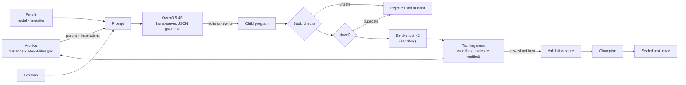

# HeuriForge

[](https://github.com/TMW17/heuriforge/actions/workflows/ci.yml)


**LLM-guided evolution of vehicle-routing heuristics, on one laptop, for $0.**

HeuriForge is a compact, carefully evaluated take on the idea behind AlphaEvolve and
FunSearch: a language model proposes changes to a program, an evolutionary search keeps
the changes that score better, and repeats. Here the model is small and local
(Qwen3.5-4B served by llama.cpp on a MacBook), and the programs are heuristics for the
capacitated vehicle routing problem (CVRP).

What it is built to answer honestly: *how much does a small local model actually add to
evolutionary program search?* So every result is measured the way a reviewer would ask
for it: model-written code runs in a sandbox, an identical search **without** a language
model is the baseline, the champion is chosen on a validation split, and it is scored
once on a **sealed** test split, with paired statistics.

## Results

> **Pending.** The runs take a few hours each on a MacBook Pro (Apple Silicon, 16 GB).
> This section is filled in from the sealed tests; the full report (charts, champion code,
> lineage, audit) will be published on GitHub Pages.

| Task | Starting point | No-LLM baseline champion | LLM champion | LLM vs no-LLM |
|---|---|---|---|---|
| 1 · Constructive heuristic | – | – | – | – |
| 2 · PyVRP acceptance rule | – | – | – | – |

*Mean gap (%) to the best-known solutions on the 20 sealed test instances (Task 2: × 5 seeds).*

Reference points measured with this repository (training / validation instances):

| | train | validation |
|---|---|---|
| Task 1 starting point: nearest neighbour | 31.53% | 29.69% |
| Task 1 reference: Clarke-Wright savings (1964) | 6.80% | 5.97% |
| Task 2 starting point: PyVRP's own rule, 1,000 iterations | 2.75% | 2.83% |

## The two tasks

**Task 1: a constructive heuristic** (in the style of EoH and ReEvo). A fixed loop builds
the routes one stop at a time; the evolved function scores the possible next stops
(`score_candidates(current, candidates, rest_capacity, capacity, demand, dist, coords, depot)`).
It starts as nearest neighbour. It is fast to evaluate, so the signal is strong. A one-stop-at-a-time
rule cannot express merge-based algorithms, so Clarke-Wright savings is reported as an
outside reference, not as a target.

**Task 2: the acceptance rule inside a state-of-the-art solver.** PyVRP 0.14 solves the CVRP
with iterated local search, and after every step it decides whether to accept the new
solution (late-acceptance hill climbing). HeuriForge replicates PyVRP's loop step for step
with that single decision made pluggable
(`accept(cand, curr, late, best, feasible, it, max_it, stall, u, state)`); a test checks that
the replica with the original rule reproduces `pyvrp.solve` exactly. Gains here are small
and hard-won, which is the point.

## How it works



- **Search.** Two islands, each with a MAP-Elites grid over code size and the number of
  inputs a program uses, so different *kinds* of good programs survive. Parents are drawn
  as in ShinkaEvolve (fitness-weighted, discounted by how many children a program already
  has); islands exchange their best program in a ring. A cost-aware Thompson-sampling
  bandit picks the model and the mutation type (small SEARCH/REPLACE edits, or a full
  rewrite). Every 25 candidates the model writes a one-line lesson from a better and a
  worse program (ReEvo-style reflection), and later prompts include the latest lessons.
- **The model.** Qwen3.5-4B (Q4_K_M, 2.7 GB) in llama.cpp's `llama-server`, with Metal on
  Apple Silicon. Thinking is turned off. Small edits come back as JSON constrained by a
  schema that llama.cpp compiles to a grammar. Full rewrites come back as a two- or
  three-sentence plan followed by a plain Python code block: inside a JSON string the
  model often never closed the string, and without a plan it reasoned in long code
  comments until it hit the token limit. Edits with a wrong indentation are re-indented
  to the lines they replace when that makes the code compile. The fixed part
  of the prompt sits in the system message, where llama.cpp checkpoints the state of this
  hybrid model, so it can be reused from one candidate to the next instead of being
  recomputed. Requests can only go to localhost.
- **Novelty.** Programs that differ only in names, comments or formatting are rejected
  before evaluation (canonical syntax-tree hash); variants that only change constants are
  capped, to push the search towards new ideas.
- **Evaluation integrity.**
  - Static checks reject forbidden imports, file and introspection access, dunder tricks,
    global state and signature changes. The worker runs the same checks again.
  - Every evaluation runs in a fresh process with restricted builtins, a guarded import,
    read-only inputs, a CPU timer per instance, a CPU-time limit, no file writes, a memory
    limit (address space on Linux, a peak-memory watchdog on macOS), a clean environment,
    and its whole process group is killed on timeout.
  - The candidate never reports a score: the parent process re-checks every route (each
    customer once, no overloaded truck) and recomputes the cost itself.
  - The smoke test runs every candidate twice on the same input; different answers mean
    hidden state, and the candidate is rejected.
  - Every rejection has a category, counted per run: the **reward-hacking audit**.
- **Statistics.** The champion is compared with the starting point and the baseline on the
  same test items: Wilcoxon signed-rank test with Holm's correction, Vargha-Delaney A12
  effect size, and a bootstrap 95% confidence interval of the mean gap difference. The
  sealed test refuses to run twice unless forced, and a forced re-run is recorded.

**Data.** The 50 CVRPLIB set X instances with 100-330 customers (Uchoa et al., 2017) with
their best-known solutions, split 20 / 10 / 20 into train / validation / test, stratified
by average route length so that every split covers short and long routes. Small synthetic
instances are generated for the smoke test, the offline demo and CI.

## Quick start

On macOS with [Homebrew](https://brew.sh) (see [BUILD_GUIDE.md](BUILD_GUIDE.md) for the
full step-by-step version, including the benchmark and publishing the results):

```bash
brew install uv llama.cpp
git clone https://github.com/TMW17/heuriforge.git ~/Projects/heuriforge
cd ~/Projects/heuriforge
make setup        # Python 3.12 + dependencies + git hooks
make test         # about 100 tests, including sandbox-escape attempts
make demo         # offline end-to-end run with a mock model (report in site-demo/)
make data         # CVRPLIB X instances + synthetic ones
make server       # terminal 2: local model server (first run downloads the model)
make bench        # Phase 0: is the model fast and reliable enough?
make construct-llm && make construct-random   # Task 1: with and without the model
make sealed-test RUN=construct-llm && make sealed-test RUN=construct-random
make report       # results website in site/
```

| Command | What it does |
|---|---|
| `make eval` | scores both starting programs (sanity check) |
| `make status RUN=…` | progress of a run, also while it runs |
| `make construct-llm RESUME=1` | continues a stopped run (Ctrl+C or a `STOP` file stop it safely) |
| `make accept-llm`, `make accept-random` | Task 2 runs |
| `make export RUN=…` | copies a run's champion and results to `results/` for committing |
| `uv run heuriforge --help` | every command and option |

All settings (model server, search parameters, budgets, time limits) are in
[`config/settings.yaml`](config/settings.yaml). Optional MLflow tracking:
`uv sync --extra tracking` and `tracking.mlflow: true`.

## Repository layout

```
config/settings.yaml            every setting, commented
config/splits/                  which instances are train / validation / test (test is sealed)
src/heuriforge/
  tasks/                        the two tasks: evolvable function, trusted skeleton, prompt text
  sandbox/                      static checks, restricted execution, the worker process
  engine.py                     the evolution loop
  archive.py, bandit.py         parent selection (MAP-Elites, islands) and arm selection
  prompts.py, llm.py            prompts, JSON schemas, llama-server client and offline mock
  mutators.py, novelty.py       random-mutation baseline, duplicate detection
  evaluator.py, instances.py    scoring, route checking, instance download and generation
  sealed_test.py, stats.py      the one-time test and its paired statistics
  report.py, bench.py, cli.py   results website, Phase 0 benchmark, command line
tests/                          unit and end-to-end tests, sandbox-escape and cheating attempts
```

## Limitations

- A 4B model writes weaker code than frontier models; the results describe what a small
  local model can do, not the ceiling of the method.
- Each configuration is evolved once (one search seed). Differences between runs of the
  search itself are not measured; repeated runs would make the comparison stronger.
- Task 2 uses a fixed budget of 1,000 iterations; a rule tuned for short runs may not
  help long ones.
- The sandbox is designed for code written by a model asked to write heuristics, not for
  hostile code from the internet. On macOS the memory limit is a best-effort watchdog.

## References

- Novikov et al. (2025). *AlphaEvolve: A coding agent for scientific and algorithmic discovery.* arXiv:2506.13131.
- Romera-Paredes et al. (2024). *Mathematical discoveries from program search with large language models.* Nature 625.
- Liu et al. (2024). *Evolution of Heuristics: Towards efficient automatic algorithm design using large language model.* ICML.
- Ye et al. (2024). *ReEvo: Large language models as hyper-heuristics with reflective evolution.* NeurIPS.
- Lange, Imajuku and Cetin (2025). *ShinkaEvolve: Towards open-ended and sample-efficient program evolution.* arXiv:2509.19349.
- Mouret and Clune (2015). *Illuminating search spaces by mapping elites.* arXiv:1504.04909.
- Wouda, Lan and Kool (2024). *PyVRP: A high-performance VRP solver package.* INFORMS Journal on Computing.
- Uchoa et al. (2017). *New benchmark instances for the capacitated vehicle routing problem.* European Journal of Operational Research 257(3).
- Burke and Bykov (2017). *The late acceptance hill-climbing heuristic.* European Journal of Operational Research 258(1).
- Clarke and Wright (1964). *Scheduling of vehicles from a central depot to a number of delivery points.* Operations Research 12(4).
- Vargha and Delaney (2000). *A critique and improvement of the CL common language effect size statistics of McGraw and Wong.* Journal of Educational and Behavioral Statistics 25(2).

## License

MIT. The CVRPLIB X instances are downloaded at run time from
[PyVRP/Instances](https://github.com/PyVRP/Instances) and are not redistributed here (one
instance is included under `tests/data` for the tests).
